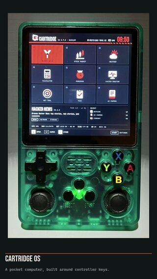

# CartridgeOS

An experimental app platform developed and tested on an R36S Plus. Turn a retro gaming handheld into a general-purpose pocket computer with WiFi, apps, and a d-pad. Other devices and firmware variants have not been validated.

Built in Rust with SDL2. Apps are scripted in Lua.

**[Build your first Cartridge app](docs/app-development.md)** — start on your
Mac with the v0.7.1 runtime, a runnable Lua counter, and the desktop simulator.
The runtime repository and its Lua APIs are the SDK.

> **Experimental software — back up your card before installing.** CartridgeOS is
> provided as-is, without warranty. Installation and boot changes can cause data
> loss or leave the card unbootable. Keep an independent backup of your working
> system, games and saves, and preferably experiment on a spare card. A similar
> product name does not guarantee compatible hardware or firmware. See
> [installation, SD-card guidance and recovery](INSTALL.md) before proceeding.

**Security update:** v0.7.1 restricts Lua library access, rejects binary Lua
chunks and closes storage path escapes. Update older installations before
adding apps. See [security reporting and app trust limits](SECURITY.md).

## See it running

[](docs/media/overview.mp4)

**[Watch the new 36-second hardware overview](docs/media/overview.mp4)** · [Photos, focused demos and simulator gallery](docs/media/README.md)

New R36S Plus footage: launcher navigation, radio-map zooming, illustrated weather, news, focus timer and system stats. The overview is edited and muted; the gallery clearly labels simulator screenshots that use sample data.

## Install on R36S Plus

The [v0.7.1 release](https://github.com/Strizzo/Cartridge/releases/tag/v0.7.1)
contains an application bundle for an **existing, working R36S Plus system**.
It is not a complete SD-card image. The macOS image installer remains a
prototype; it is not a general-purpose public installer.

1. Back up your working card, games and saves. Download
   `cartridge-r36s-plus.zip` from that release.
2. Power off the handheld, insert its card into your computer, and open the
   existing ROMS volume (often labelled `EASYROMS`).
3. Extract the `Cartridge/` folder into the root of that volume. Copy the three
   scripts from `Cartridge/tools/` into its existing `tools/` folder, keeping
   other tools and games in place. See [INSTALL.md](INSTALL.md) for the layout
   and archive checksum.
4. Safely eject, boot normally into EmulationStation, then open
   **Options → Tools → Cartridge** and confirm the launcher works.
5. Only after that check, optionally run **Tools → Setup Cartridge Boot**.
   In v0.7.1 this enables direct Cartridge startup at the next normal boot,
   with EmulationStation retained as fallback. Setup does not reboot for you.

[INSTALL.md](INSTALL.md) explains returning to EmulationStation, the recovery
file, and the limits of this tested setup. Do not follow legacy boot-selector
instructions for this release.

**Source and documentation:** `main` contains the released **v0.7.1 runtime**,
plus current documentation and media. Use the immutable
[`v0.7.1`](https://github.com/Strizzo/Cartridge/tree/v0.7.1) tag to reproduce the
release source. The [simulator guide](docs/simulator.md) and
[app development guide](docs/app-development.md) describe the current platform.

### Try the simulator first

On a Mac with Rust and the SDL dependencies listed below installed:

```bash
./sim.sh                             # native launcher, keyboard or gamepad
./sim.sh app lua_cartridges/calculator
./sim.sh check                       # automated UI/app checks; no SD card
```

The simulator runs the actual UI and Lua apps at 720×720 with isolated app
storage and simulated device readings. It does not emulate the handheld GPU,
drivers or battery behavior. See [ARM VM checks](docs/arm-vm.md) for the separate
Linux compatibility and startup/rollback rehearsal.

## Architecture

Cargo workspace with the following crates:

| Crate | Description |
|-------|-------------|
| `cartridge-core` | Core types: screen, input, theme, storage, fonts |
| `cartridge-runner` | SDL2 game loop, window management, rendering |
| `cartridge-lua` | Lua scripting engine (app lifecycle, API bindings) |
| `cartridge-net` | HTTP client and networking for Lua apps |
| `cartridge-launcher` | On-device launcher UI and app switching |
| `cartridge-boot` | Device bootstrap and EmulationStation integration |

The top-level `cartridge` binary ties everything together as the single entry point.

## Building

Requires Rust, SDL2, SDL2_ttf, SDL2_image and SDL2_gfx development libraries:

```bash
# macOS
brew install sdl2 sdl2_ttf sdl2_image sdl2_gfx

# Debian/Ubuntu
sudo apt-get install libsdl2-dev libsdl2-ttf-dev libsdl2-image-dev libsdl2-gfx-dev libasound2-dev
```

Then build:

```bash
cargo build --release
```

## Running

```bash
# Launch the launcher (default)
cargo run

# Run a specific Lua app
cargo run -- run --path lua_cartridges/calculator

# Show the demo screen
cargo run -- demo
```

### Controls (Desktop)

| Key | Button | Action |
|-----|--------|--------|
| Arrow keys | D-pad | Navigate |
| Z | A | Confirm / Select |
| X | B | Back / Cancel |
| C | X | Action 1 |
| V | Y | Action 2 |
| A / S | L1 / R1 | Tab left / right |
| Q / W | L2 / R2 | Page up / down |
| Return | Start | Menu |
| Space | Select | Toggle |
| Esc | — | Quit |

## Cross-Compilation (aarch64)

The CI device build uses `docker/Dockerfile.device` to match the supported
handheld's Linux library baseline. With Docker running:

```bash
docker build -f docker/Dockerfile.device -t cartridge-device .
docker run --rm -v "$PWD":/src -w /src cartridge-device \
  cargo build --workspace --release --target aarch64-unknown-linux-gnu
```

This builds binaries only. Follow [INSTALL.md](INSTALL.md) before putting a
bundle on a physical card.

## Lua App SDK

Apps are "cartridges" — small Lua programs with a simple lifecycle:

```lua
function on_init()
    -- Load data, set up state
end

function on_input(button, action)
    -- Handle button presses and releases
end

function on_update(dt)
    -- Update state each frame (dt = seconds since last frame)
end

function on_render()
    screen.clear(theme.bg.r, theme.bg.g, theme.bg.b)
    screen.draw_text("Hello", 20, 20, { bold = true, size = 24 })
end
```

### Available APIs

| Module | Description |
|--------|-------------|
| `screen` | 720×720 drawing surface — text, shapes, colors |
| `theme` | Consistent dark theme with accent colors |
| `storage` | Scoped key-value persistence per app |
| `http` | HTTP requests for fetching data |
| `json` | JSON encode/decode |
| `ssh` | SSH tunnel management |

## Bundled Apps

| App | Category | Description |
|-----|----------|-------------|
| Calculator | Tools | Calculator with expression history |
| Hacker News | News | Browse top stories, comments, and articles |
| Pomodoro | Productivity | Focus timer with work/break cycles and stats |
| Stock Market | Finance | Track stocks, crypto, indices with live charts |
| System Monitor | Tools | Real-time CPU, memory, disk, and network monitoring |
| Weather | Tools | Current conditions and 5-day forecast |

## Community Cartridges

| App | Category | Description |
|-----|----------|-------------|
| [VibeBoy](https://github.com/Strizzo/vibeboy-cartridge) | Tools | Remote control for VibeBoy daemon, manage tmux sessions and Claude Code |
| [World Pulse](https://github.com/Strizzo/worldpulse-cartridge) | Preview | Experimental live-data dashboard; held out of the Store pending provider verification |

## Creating Cartridges

A cartridge is a directory with a `cartridge.json` manifest and a Lua entry point:

```
my-cartridge/
  cartridge.json
  main.lua
  icon.png          # optional, 64x64
```

The manifest describes your app:

```json
{
    "id": "dev.cartridge.my-app",
    "name": "My App",
    "version": "0.1.0",
    "author": "Your Name",
    "description": "What it does",
    "category": "tools",
    "tags": ["example"],
    "permissions": ["network", "storage"],
    "entry": "main.lua"
}
```

Available permissions: `network`, `storage`, `audio`, `system`, `input`, `ssh`.

### Lua API reference

Full API docs live in **[`docs/lua-api.md`](docs/lua-api.md)** — drawing
primitives, lifecycle callbacks, input events, networking, storage,
audio, system info, on-screen keyboard, and SSH tunneling.

For a runnable starter, see **`lua_cartridges/hello_world/`** — a 90-line
example covering input, drawing, and audio.

### Testing locally

```bash
cargo run -- run --path /path/to/my-cartridge
```

### Performance & visual regression tools

CartridgeOS ships a headless test harness for iterating without a device
(see [`docs/testing.md`](docs/testing.md)):

```bash
cargo run --bin perf-bench --release    # frame-time stats with thresholds
cargo run --bin snapshot                # PNG captures of UI screens
cargo test --test snapshot_test         # visual regression test
CARTRIDGE_FPS=1 ./dev-run.sh            # on-screen FPS overlay
```

### Publishing to the Store

Apps live in their own repositories, with versioned release packages. The
[official catalogue](https://github.com/Strizzo/cartridge-apps) contains signed
metadata pointing to those packages, including hashes, exact sizes, permissions
and minimum runtime versions. The `registry.json` shipped here is the bundled
offline fallback; adding a link there does not publish a downloadable Store app.

Follow the [Store publishing guide](docs/app-store.md) for packaging, validation
and catalogue review. No account or GitHub token is required on the handheld.

## Project Structure

```
Cartridge/
  Cargo.toml                  # Workspace root
  Cross.toml                  # cross-rs config
  src/main.rs                 # Binary entry point
  crates/
    cartridge-core/           # Core types and abstractions
    cartridge-runner/         # SDL2 game loop and rendering
    cartridge-lua/            # Lua scripting engine
    cartridge-net/            # HTTP and networking
    cartridge-launcher/       # Launcher UI
    cartridge-boot/           # Device bootstrap
  assets/fonts/               # Bundled fonts and license notices
  lua_cartridges/             # Bundled Lua apps
  install.sh                  # Build script
  install_to_device.sh        # Cross-compile and deploy to device
```

## Device Deployment

Cross-compile for aarch64, then copy the binary, `assets/`, and `lua_cartridges/` to the device. See `install_to_device.sh` for automated deployment.

## License

See [LICENSE](LICENSE) for the project's license terms.
