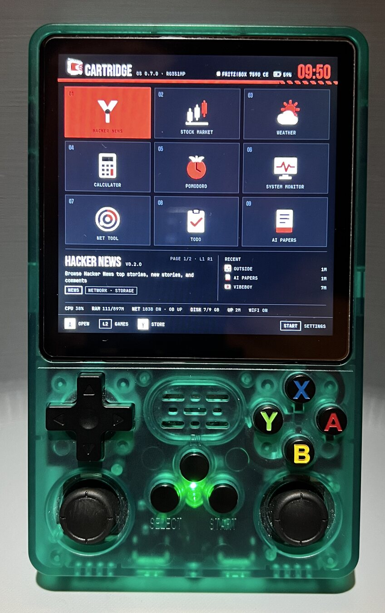
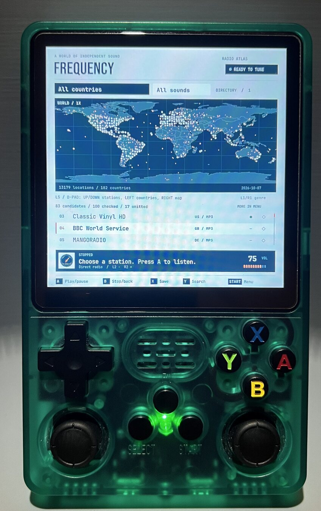
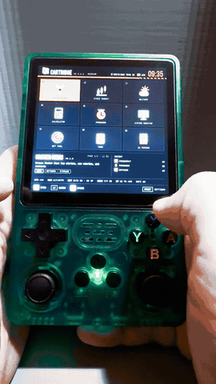
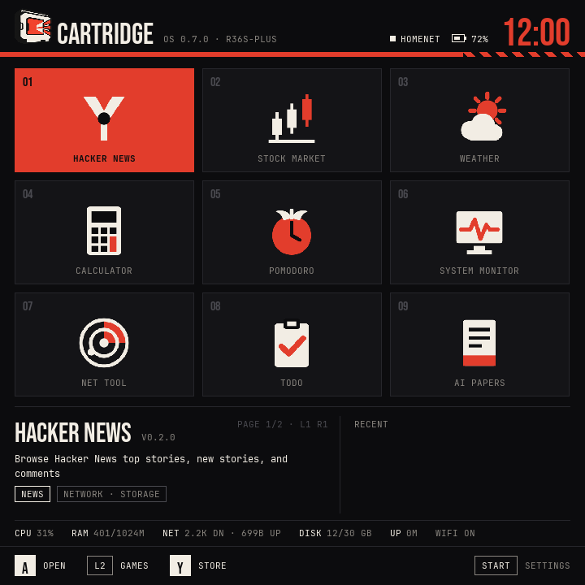
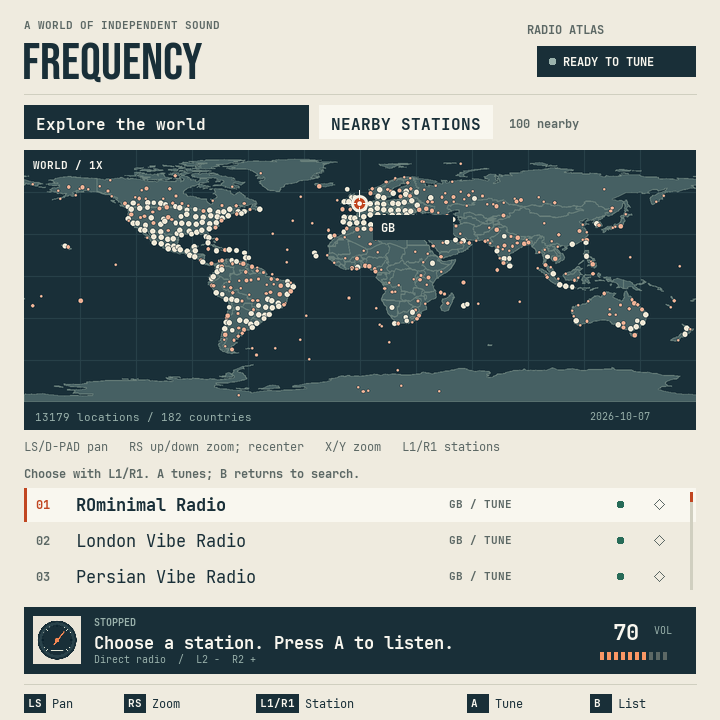
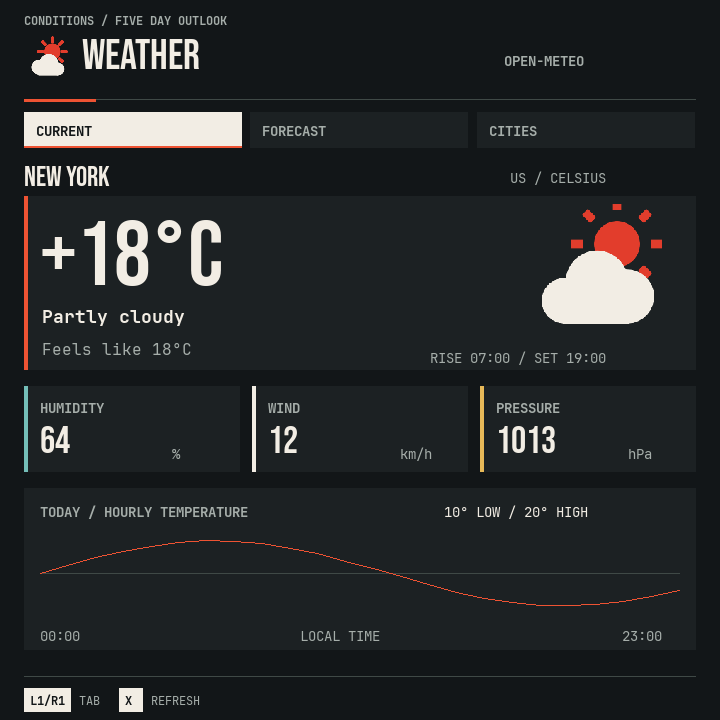
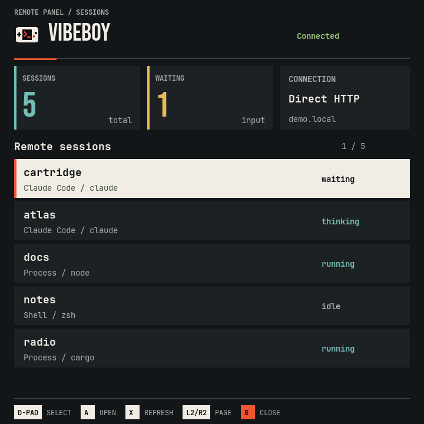
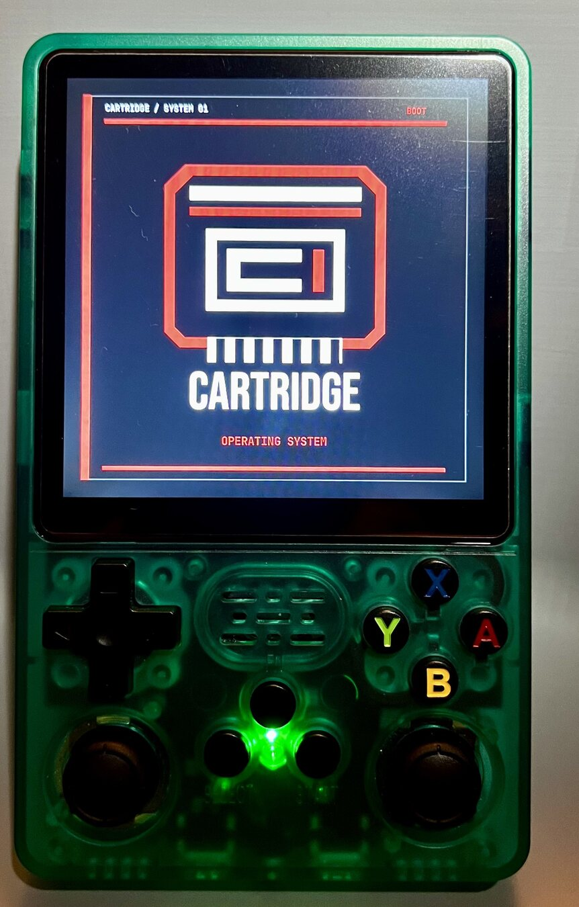

# CartridgeOS in pictures

Real-device photographs and edited demonstrations from an R36S Plus. The original footage was recorded on 2026-10-13; the simulator captures were rendered on 2026-10-17 from CartridgeOS 0.7.0.

## Hardware overview

**[Watch the 43-second overview](overview.mp4).** Launcher navigation, news, markets, a focus timer, system details, radio browsing and weather on actual hardware. This is an edited highlight reel with titles added outside the filmed device image. Audio is omitted; footage runs at normal speed.

| The launcher | Frequency on the device |
|---|---|
|  |  |

## Focused demos

- [Launcher navigation — 10.8 seconds](launcher-demo.mp4): continuous D-pad navigation through the app grid.
- [Frequency — 13.8 seconds](frequency-demo.mp4): continuous station selection on the radio map. Audio omitted.

The MP4 files are smaller web copies at 540×960 with H.264 video and fast-start metadata. The animated preview is deliberately small; use the linked video for a clearer view.

## Native simulator captures

These are actual **720×720** renders of the app code, with **simulated or fixture data**. They are not device photographs or live system measurements. Individual app versions in the physical recordings may differ from the simulator builds.

| Launcher | Frequency |
|---|---|
|  |  |

| Weather | VibeBoy |
|---|---|
|  |  |

## Boot artwork

A photograph of the startup artwork. This is not a timed boot demonstration.

## Captions and provenance

The media derives from recordings and photographs supplied by the project owner. Camera HDR footage was converted to SDR Rec.709 for browser playback; photographs were cropped and resized. Exported media omits embedded location metadata. Device screens were not replaced or composited, and no footage was sped up.

[media-provenance.json](media-provenance.json) records the source filenames, exact in/out times, screenshot provenance and exported file checksums. Complete original recordings are not stored in this repository. The full local blog kit additionally contains seven focused cuts, full-size stills, all six simulator captures, English captions, alt text, SRT/VTT tracks and copy-and-paste embed examples.
